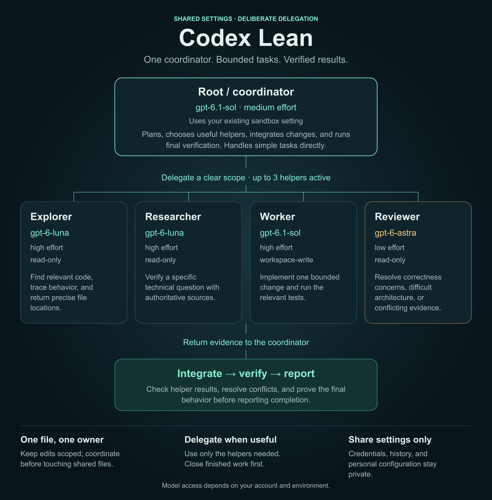

# Codex Lean

A shareable Codex setup: a Sol coordinator, Luna helpers for investigation, a Sol worker for implementation, and an Astra reviewer for difficult decisions.



Open the [HTML agent map](docs/infographic.html) in a browser for the responsive version. The editable [SVG image](docs/infographic.svg) is also included. Both work offline.

## How it works

| Role | Model | Effort | Access | Job |
|---|---|---|---|---|
| Root / coordinator | `gpt-6.1-sol` | medium | Your existing sandbox setting | Plans, integrates, and performs final verification |
| `explorer` | `gpt-6-luna` | high | Read-only | Traces code and returns relevant file locations |
| `researcher` | `gpt-6-luna` | high | Read-only | Verifies specific questions against authoritative sources |
| `worker` | `gpt-6.1-sol` | high | Workspace-write | Implements one bounded change and runs relevant tests |
| `reviewer` | `gpt-6-astra` | low | Read-only | Reviews unresolved correctness concerns or difficult architecture |

Handle simple tasks directly. Delegate bounded work when it helps, keep at most three helpers active, and assign one owner per edited file. The coordinator checks helper results and runs final validation.

Model availability depends on your account and Codex environment. If one of these model identifiers is unavailable, choose an available model and update both the root configuration and the relevant role files before installing.

## What's included

```text
codex/
  AGENTS.md             shared planning, verification, and delegation rules
  config.toml           root model, effort, and agent configuration
  agents/
    explorer.toml
    researcher.toml
    worker.toml
    reviewer.toml
docs/
  infographic.png       agent map embedded in this README
  infographic.svg       editable vector image
  infographic.html      offline, responsive agent map
scripts/
  install.py            merge and backup implementation
tests/
  test_install.py       installation and preservation checks
install.sh
```

The template excludes credentials, auth state, chat history, personal project configuration, MCP servers, plugins, and skills. Review the supplied rules and model choices before sharing or installing.

## Install

Requires Python 3.11 or newer and a shell that can run `install.sh`.

```bash
git clone https://github.com/thawee/codex-lean.git
cd codex-lean
./install.sh
```

The installer uses `$CODEX_HOME` when set, otherwise `~/.codex`. It merges the supplied root `model`, `model_reasoning_effort`, and agent settings into `config.toml`, including each supplied role's description and `config_file`. Other existing settings are preserved semantically; TOML formatting and comments are rewritten.

It replaces the global `AGENTS.md` and the four supplied role files. Every replaced file is backed up in a unique backup directory under the installation directory. If you have custom global rules or role definitions, merge them back from that backup after installation.

To choose another destination:

```bash
CODEX_HOME=/path/to/.codex ./install.sh
```

Start a new Codex session after installing. Keep your existing approval and sandbox settings appropriate for your workspace; the installer preserves those root settings.

### Manual install

1. Copy `codex/agents/*.toml` into `$CODEX_HOME/agents/` (or `~/.codex/agents/`).
2. Merge the rules from `codex/AGENTS.md` into the destination's `AGENTS.md`.
3. Merge `model`, `model_reasoning_effort`, and the `[agents]` configuration from `codex/config.toml` into the destination's `config.toml`. Keep the role `config_file` paths relative to that configuration file, as in the template.

### One project only

Place `codex/config.toml` at `.codex/config.toml`, copy the four role files into `.codex/agents/`, and merge `codex/AGENTS.md` into `AGENTS.md` at the repository root. Commit those files to share the setup with collaborators. Each collaborator may need to trust the project before Codex loads its project configuration.

The project configuration should use the same relative role paths as the supplied template. Do not run the global installer for a project-only setup.

For supported configuration fields and precedence, see the [Codex configuration reference](https://learn.chatgpt.com/docs/config-file/config-reference).

## Verify changes

Run the installer tests before sharing a modified template:

```bash
python3 -m unittest discover -s tests -v
```

The tests install into temporary directories and check merging, backups, and preservation of existing settings.

## Share with friends

If this folder is not yet a Git repository, initialize it and commit the portable files:

```bash
git init -b main
git add .gitignore README.md codex docs install.sh scripts/install.py tests/test_install.py
git commit -m "Add lean Codex settings"
```

Create an empty repository on your preferred Git hosting service, then publish:

```bash
git remote add origin https://github.com/thawee/codex-lean.git
git push -u origin main
```

Send friends the repository URL and the installation instructions above.
